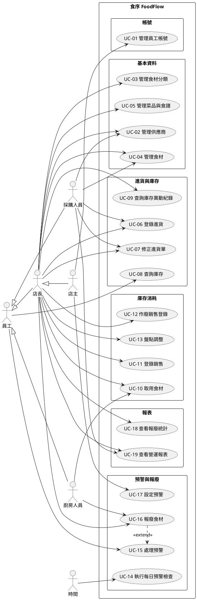

# 食序 FoodFlow Use Case 規格

## 0. 說明

本文件依課本 Kung《Object-Oriented Software Engineering: An Agile Unified Methodology》的方法，從 PRD 的功能需求（FR-1 ~ FR-27）推導 Use Case，屬於軟體需求分析文件 (b) 的一部分。

推導步驟：
1. **識別 Use Case**：從 FR 中找出「由參與者發起、為參與者完成一項業務工作」的業務流程（§2）。
2. **界定範圍**：以 High-level Use Case 描述每個 Use Case 的起點（TUCBW, This Use Case Begins With）與終點（TUCEW, This Use Case Ends With）（§3）。
3. **追溯與排定優先順序**：建立需求與 Use Case 的追溯矩陣，依需求權重計算 Use Case 優先順序（§4）。
4. **Use Case Diagram**：以圖呈現參與者與 Use Case 的關係（§5）。
5. **Expanded Use Case**：以參與者與系統的雙欄互動表描述流程（§6）。

用語一律依 PRD §3 名詞定義。

## 1. 參與者

| 參與者 | 類型 | 說明 |
|---|---|---|
| 員工 | 抽象參與者 | 所有登入系統的使用者，下列四種角色皆屬之 |
| 店主 | 主要參與者 | 繼承店長的所有 Use Case，另可管理員工帳號與系統設定 |
| 店長 | 主要參與者 | 負責日常營運：基本資料、進貨、取用、銷售登錄、盤點、報廢、報表 |
| 採購人員 | 主要參與者 | 負責供應商、食材資料與進貨 |
| 廚房人員 | 主要參與者 | 負責取用與報廢 |
| 時間 | 參與者（排程） | 每日定時觸發預警檢查與 Email 寄送 |

## 2. Use Case 清單

依子系統分組。登入（FR-1）與依角色控制權限（FR-3）是所有 Use Case 共用的前置條件，屬於步驟而非獨立的業務流程，因此不單獨列為 Use Case（見 §4 說明）。

| 子系統 | 編號 | Use Case | 主要參與者 | 對應 FR |
|---|---|---|---|---|
| 帳號 | UC-01 | 管理員工帳號 | 店主 | FR-2 |
| 基本資料 | UC-02 | 管理供應商 | 店長、採購人員 | FR-4 |
| 基本資料 | UC-03 | 管理食材分類 | 店長 | FR-5 |
| 基本資料 | UC-04 | 管理食材 | 店長、採購人員 | FR-6 |
| 基本資料 | UC-05 | 管理菜品與食譜 | 店長 | FR-7 |
| 進貨與庫存 | UC-06 | 登錄進貨 | 採購人員、店長 | FR-8 |
| 進貨與庫存 | UC-07 | 修正進貨單 | 採購人員、店長 | FR-9 |
| 進貨與庫存 | UC-08 | 查詢庫存 | 員工 | FR-10、FR-11 |
| 進貨與庫存 | UC-09 | 查詢庫存異動紀錄 | 店長 | FR-12 |
| 庫存消耗 | UC-10 | 取用食材 | 廚房人員、店長 | FR-13、FR-14 |
| 庫存消耗 | UC-11 | 登錄銷售 | 店長 | FR-15 |
| 庫存消耗 | UC-12 | 作廢銷售登錄 | 店長 | FR-15 |
| 庫存消耗 | UC-13 | 盤點調整 | 店長 | FR-16 |
| 預警與報廢 | UC-14 | 執行每日預警檢查 | 時間 | FR-17、FR-19 |
| 預警與報廢 | UC-15 | 處理預警 | 員工 | FR-18、FR-22 |
| 預警與報廢 | UC-16 | 報廢食材 | 廚房人員、店長 | FR-21、FR-22 |
| 預警與報廢 | UC-17 | 設定預警 | 店主 | FR-20 |
| 報表 | UC-18 | 查看報廢統計 | 店長 | FR-23、FR-27 |
| 報表 | UC-19 | 查看營運報表 | 店長、採購人員 | FR-24、FR-25、FR-26、FR-27 |

`[ASSUMPTION]` UC-08 查詢庫存開放給所有員工；PRD 權限表未列出此項，依「廚房人員需要知道庫存」推論。

## 3. High-level Use Case

- **UC-01 管理員工帳號**：TUCBW 店主點選「員工管理」；TUCEW 店主看到更新後的員工清單。
- **UC-02 管理供應商**：TUCBW 使用者點選「供應商管理」；TUCEW 使用者看到更新後的供應商清單。
- **UC-03 管理食材分類**：TUCBW 使用者點選「食材分類管理」；TUCEW 使用者看到更新後的分類清單。
- **UC-04 管理食材**：TUCBW 使用者點選「食材管理」；TUCEW 使用者看到更新後的食材清單。
- **UC-05 管理菜品與食譜**：TUCBW 使用者點選「菜品管理」；TUCEW 使用者看到菜品及其食譜已儲存。
- **UC-06 登錄進貨**：TUCBW 採購人員點選「新增進貨單」；TUCEW 採購人員看到進貨單已建立，且各食材的庫存批次已新增。
- **UC-07 修正進貨單**：TUCBW 使用者在進貨單查詢中選擇一張進貨單；TUCEW 使用者看到修正或作廢後的進貨明細與庫存。
- **UC-08 查詢庫存**：TUCBW 員工點選「庫存查詢」；TUCEW 員工看到所選食材的庫存批次明細。
- **UC-09 查詢庫存異動紀錄**：TUCBW 店長點選「庫存異動紀錄」；TUCEW 店長看到符合條件的庫存異動紀錄。
- **UC-10 取用食材**：TUCBW 廚房人員點選「取用」；TUCEW 廚房人員看到取用完成，以及各批次扣除的數量。
- **UC-11 登錄銷售**：TUCBW 店長點選「銷售登錄」；TUCEW 店長看到銷售登錄完成與扣料結果。
- **UC-12 作廢銷售登錄**：TUCBW 店長在銷售登錄清單中選擇一筆登錄；TUCEW 店長看到該登錄已作廢且庫存已回補。
- **UC-13 盤點調整**：TUCBW 店長在批次明細中點選「盤點」；TUCEW 店長看到批次數量已更新為實際數量。
- **UC-14 執行每日預警檢查**：TUCBW 到達設定的每日檢查時間；TUCEW 預警已更新，且預警摘要 Email 已寄出（或因無預警而不寄送）。
- **UC-15 處理預警**：TUCBW 員工登入後進入預警儀表板；TUCEW 員工看到預警清單，或已前往對應的處理功能。
- **UC-16 報廢食材**：TUCBW 使用者點選「報廢」或在過期預警上點選「快速報廢」；TUCEW 使用者看到報廢完成與損失金額。
- **UC-17 設定預警**：TUCBW 店主點選「預警設定」；TUCEW 店主看到設定已儲存。
- **UC-18 查看報廢統計**：TUCBW 使用者點選「報廢統計」；TUCEW 使用者看到報廢統計圖表，或已下載 CSV 檔案。
- **UC-19 查看營運報表**：TUCBW 使用者點選「營運報表」並選擇報表種類；TUCEW 使用者看到報表結果，或已下載 CSV 檔案。

## 4. 需求與 Use Case 追溯矩陣

權重 1 ~ 5，數字越大代表該需求對產品價值越關鍵。`[ASSUMPTION: 權重由 PM 依 PRD §1 核心亮點（批次、FEFO、預警、報廢分析）推論，待團隊確認]`

| 需求 | 權重 | UC-01 | UC-02 | UC-03 | UC-04 | UC-05 | UC-06 | UC-07 | UC-08 | UC-09 | UC-10 | UC-11 | UC-12 | UC-13 | UC-14 | UC-15 | UC-16 | UC-17 | UC-18 | UC-19 |
|---|:-:|:-:|:-:|:-:|:-:|:-:|:-:|:-:|:-:|:-:|:-:|:-:|:-:|:-:|:-:|:-:|:-:|:-:|:-:|:-:|
| FR-1 ※ | 5 |  |  |  |  |  |  |  |  |  |  |  |  |  |  |  |  |  |  |  |
| FR-2 | 3 | X |  |  |  |  |  |  |  |  |  |  |  |  |  |  |  |  |  |  |
| FR-3 ※ | 4 |  |  |  |  |  |  |  |  |  |  |  |  |  |  |  |  |  |  |  |
| FR-4 | 3 |  | X |  |  |  |  |  |  |  |  |  |  |  |  |  |  |  |  |  |
| FR-5 | 2 |  |  | X |  |  |  |  |  |  |  |  |  |  |  |  |  |  |  |  |
| FR-6 | 4 |  |  |  | X |  |  |  |  |  |  |  |  |  |  |  |  |  |  |  |
| FR-7 | 4 |  |  |  |  | X |  |  |  |  |  |  |  |  |  |  |  |  |  |  |
| FR-8 | 5 |  |  |  |  |  | X |  |  |  |  |  |  |  |  |  |  |  |  |  |
| FR-9 | 3 |  |  |  |  |  |  | X |  |  |  |  |  |  |  |  |  |  |  |  |
| FR-10 | 4 |  |  |  |  |  |  |  | X |  |  |  |  |  |  |  |  |  |  |  |
| FR-11 | 5 |  |  |  |  |  |  |  | X |  |  |  |  |  |  |  |  |  |  |  |
| FR-12 | 3 |  |  |  |  |  |  |  |  | X |  |  |  |  |  |  |  |  |  |  |
| FR-13 | 5 |  |  |  |  |  |  |  |  |  | X |  |  |  |  |  |  |  |  |  |
| FR-14 | 4 |  |  |  |  |  |  |  |  |  | X |  |  |  |  |  |  |  |  |  |
| FR-15 | 4 |  |  |  |  |  |  |  |  |  |  | X | X |  |  |  |  |  |  |  |
| FR-16 | 3 |  |  |  |  |  |  |  |  |  |  |  |  | X |  |  |  |  |  |  |
| FR-17 | 5 |  |  |  |  |  |  |  |  |  |  |  |  |  | X |  |  |  |  |  |
| FR-18 | 5 |  |  |  |  |  |  |  |  |  |  |  |  |  |  | X |  |  |  |  |
| FR-19 | 3 |  |  |  |  |  |  |  |  |  |  |  |  |  | X |  |  |  |  |  |
| FR-20 | 2 |  |  |  |  |  |  |  |  |  |  |  |  |  |  |  |  | X |  |  |
| FR-21 | 5 |  |  |  |  |  |  |  |  |  |  |  |  |  |  |  | X |  |  |  |
| FR-22 | 4 |  |  |  |  |  |  |  |  |  |  |  |  |  |  | X | X |  |  |  |
| FR-23 | 5 |  |  |  |  |  |  |  |  |  |  |  |  |  |  |  |  |  | X |  |
| FR-24 | 3 |  |  |  |  |  |  |  |  |  |  |  |  |  |  |  |  |  |  | X |
| FR-25 | 2 |  |  |  |  |  |  |  |  |  |  |  |  |  |  |  |  |  |  | X |
| FR-26 | 3 |  |  |  |  |  |  |  |  |  |  |  |  |  |  |  |  |  |  | X |
| FR-27 | 2 |  |  |  |  |  |  |  |  |  |  |  |  |  |  |  |  |  | X | X |
| **UC 優先權重** | | **3** | **3** | **2** | **4** | **4** | **5** | **3** | **9** | **3** | **9** | **4** | **4** | **3** | **8** | **9** | **9** | **2** | **7** | **10** |

※ 前置條件，不對應單一 Use Case。

**說明：**
- FR-1（登入）與 FR-3（權限控制）是所有 Use Case 的前置條件，不對應到單一 Use Case。
- FR-17（產生預警）除了由 UC-14 每日執行，UC-06、07、10、11、12、13、16 造成庫存異動後也會觸發預警重新評估，這部分記在各 Use Case 的後置條件中。為了避免灌水優先權重，矩陣只計入 UC-14。
- **開發順序不只看優先權重**：UC-06 登錄進貨的權重不高，卻是所有庫存相關 Use Case 的資料來源；UC-02 ~ UC-05 基本資料也是前置條件。建議迭代順序：
  1. **迭代 1**：UC-01 ~ UC-06、UC-08（先能建立資料、進貨、查詢）
  2. **迭代 2**：UC-10、UC-16、UC-14、UC-15（核心亮點：FEFO、報廢、預警）
  3. **迭代 3**：UC-11、UC-12、UC-13、UC-07、UC-09、UC-17、UC-18、UC-19

## 5. Use Case Diagram

以 PlantUML 撰寫，可貼到 https://www.plantuml.com/plantuml 或在 IDE 外掛中產生圖檔。

UC-16 報廢食材 以 `<<extend>>` 擴充 UC-15 處理預警：在過期預警上點選「快速報廢」時，由 UC-15 進入 UC-16（FR-22）。

## 6. Expanded Use Case

所有 Use Case 的共同前置條件：員工已登入系統，且其角色有權使用該功能（FR-1、FR-3）。以下各 Use Case 只列出額外的前置條件。

---

### UC-01 管理員工帳號

- **參與者**：店主
- **目的**：建立、修改、停用員工帳號並指派角色。
- **追溯需求**：FR-2
- **前置條件**：無
- **後置條件**：員工資料已更新；新員工可依角色登入；停用的員工無法登入。

| 參與者動作 | 系統回應 |
|---|---|
| 1. 店主點選「員工管理」。 | 2. 系統顯示員工清單（姓名、帳號、角色、狀態）。 |
| 3. 店主點選「新增員工」。 | 4. 系統顯示員工資料表單。 |
| 5. 店主輸入姓名、帳號、初始密碼，選擇角色，並送出。 | 6. 系統確認帳號未重複，以雜湊方式儲存密碼，建立員工資料，並顯示更新後的員工清單。 |

**替代流程：**
- 3a. 修改員工：店主選擇員工並修改姓名或角色，系統儲存後顯示更新後的清單。
- 3b. 停用員工：店主選擇員工並點選「停用」，系統將該員工狀態設為停用。若該員工是最後一位啟用中的店主，系統拒絕並提示「至少需保留一位店主」。
- 6a. 帳號已存在：系統提示帳號重複，回到步驟 4。

---

### UC-02 管理供應商

- **參與者**：店長、採購人員
- **目的**：維護供應商資料。
- **追溯需求**：FR-4
- **前置條件**：無
- **後置條件**：供應商資料已更新；停用的供應商不再出現在新增進貨單的選單中。

| 參與者動作 | 系統回應 |
|---|---|
| 1. 使用者點選「供應商管理」。 | 2. 系統顯示供應商清單。 |
| 3. 使用者點選「新增供應商」，輸入名稱、聯絡人、電話、Email、地址並送出。 | 4. 系統驗證必填欄位，儲存供應商，並顯示更新後的清單。 |

**替代流程：**
- 3a. 修改供應商：使用者選擇供應商並修改資料，系統儲存。
- 3b. 刪除供應商：若該供應商已有進貨紀錄，系統拒絕刪除，並提示改為停用；若沒有，系統刪除該供應商。
- 4a. 必填欄位未填：系統標示缺漏欄位，回到步驟 3。

---

### UC-03 管理食材分類

- **參與者**：店長
- **目的**：維護食材分類。
- **追溯需求**：FR-5
- **前置條件**：無
- **後置條件**：分類資料已更新。

| 參與者動作 | 系統回應 |
|---|---|
| 1. 使用者點選「食材分類管理」。 | 2. 系統顯示分類清單及各分類的食材數量。 |
| 3. 使用者輸入新分類名稱並送出。 | 4. 系統確認名稱未重複，儲存分類，並顯示更新後的清單。 |

**替代流程：**
- 3a. 修改分類名稱：系統儲存修改。
- 3b. 刪除分類：若分類底下仍有食材，系統拒絕並提示；否則刪除。
- 4a. 名稱重複：系統提示，回到步驟 3。

---

### UC-04 管理食材

- **參與者**：店長、採購人員
- **目的**：維護食材資料，包含預警所需的安全庫存量與預設保存天數。
- **追溯需求**：FR-6
- **前置條件**：至少已有一個食材分類。
- **後置條件**：食材資料已更新；若安全庫存量有變更，系統重新評估該食材的低庫存預警。

| 參與者動作 | 系統回應 |
|---|---|
| 1. 使用者點選「食材管理」。 | 2. 系統顯示食材清單，可依分類篩選。 |
| 3. 使用者點選「新增食材」。 | 4. 系統顯示表單，分類與預設供應商以下拉選單提供。 |
| 5. 使用者輸入名稱、分類、單位、安全庫存量、預設保存天數、保存方式、預設供應商並送出。 | 6. 系統驗證資料（安全庫存量 ≥ 0、預設保存天數 > 0），儲存食材，並顯示更新後的清單。 |

**替代流程：**
- 3a. 修改食材：使用者修改資料，系統儲存。若該食材已有庫存批次，單位欄位不可修改。
- 3b. 刪除食材：若該食材已有庫存批次或庫存異動，系統拒絕刪除並提示改為停用。
- 6a. 驗證失敗：系統標示錯誤欄位，回到步驟 5。

---

### UC-05 管理菜品與食譜

- **參與者**：店長
- **目的**：建立菜品及其食譜，作為銷售扣料的依據。
- **追溯需求**：FR-7
- **前置條件**：食譜要用到的食材已建立。
- **後置條件**：菜品與食譜已儲存，可用於 UC-11 登錄銷售。

| 參與者動作 | 系統回應 |
|---|---|
| 1. 使用者點選「菜品管理」。 | 2. 系統顯示菜品清單，並標示哪些菜品尚未設定食譜。 |
| 3. 使用者點選「新增菜品」，輸入菜品名稱與售價。 | 4. 系統顯示食譜編輯區。 |
| 5. 使用者逐筆選擇食材並輸入每份用量。 | 6. 系統在每筆用量旁顯示該食材的庫存單位。 |
| 7. 使用者點選「儲存」。 | 8. 系統驗證每筆用量 > 0 且食材不重複，儲存菜品與食譜。 |

**替代流程：**
- 3a. 修改菜品或食譜：使用者選擇菜品，增刪或修改食譜明細後儲存。修改只影響之後的銷售登錄，不影響已完成的扣料。
- 8a. 驗證失敗：系統標示錯誤明細，回到步驟 5。

---

### UC-06 登錄進貨

- **參與者**：採購人員、店長
- **目的**：記錄進貨，並為每筆進貨明細建立庫存批次。
- **追溯需求**：FR-8；實現 UJ-1
- **前置條件**：供應商與食材已建立。
- **後置條件**：進貨單、進貨明細、庫存批次、類型為「進貨」的庫存異動皆已建立；系統重新評估相關食材的低庫存預警（FR-17）。

| 參與者動作 | 系統回應 |
|---|---|
| 1. 採購人員點選「新增進貨單」。 | 2. 系統顯示進貨單表單，進貨日期預設為今天。 |
| 3. 採購人員選擇供應商。 | 4. 系統顯示新增進貨明細的欄位。 |
| 5. 採購人員選擇食材，輸入數量與單價。 | 6. 系統以「進貨日期 + 該食材預設保存天數」帶入建議有效日期，並帶入預設存放位置。 |
| 7. 採購人員確認或修改有效日期、存放位置，加入明細。重複步驟 5 ~ 7 直到所有品項輸入完成。 | 8. 系統顯示明細清單與進貨總金額。 |
| 9. 採購人員點選「送出」。 | 10. 系統驗證每筆明細（數量 > 0、單價 ≥ 0、有效日期不早於進貨日期），建立進貨單與進貨明細；每筆明細各建立一個庫存批次（自動產生批號）及一筆「進貨」庫存異動，並顯示進貨完成畫面與各批次批號。 |

**替代流程：**
- 7a. 刪除尚未送出的明細：系統從明細清單移除該筆。
- 10a. 驗證失敗：系統標示錯誤明細，回到步驟 7，已輸入的資料保留。
- 10b. 進貨單沒有任何明細：系統拒絕送出並提示。

---

### UC-07 修正進貨單

- **參與者**：採購人員、店長
- **目的**：修正輸入錯誤的進貨明細。
- **追溯需求**：FR-9
- **前置條件**：進貨單已存在。
- **後置條件**：進貨明細與對應的庫存批次已同步修正，並產生對應的庫存異動；系統重新評估相關預警（FR-17）。

| 參與者動作 | 系統回應 |
|---|---|
| 1. 使用者點選「進貨單查詢」，輸入日期區間、供應商或食材條件。 | 2. 系統顯示符合條件的進貨單清單。 |
| 3. 使用者選擇一張進貨單。 | 4. 系統顯示進貨明細，並標示每筆明細的批次是否已有後續異動（可修改／不可修改）。 |
| 5. 使用者選擇一筆可修改的明細，修改數量、單價或有效日期並送出。 | 6. 系統更新進貨明細與庫存批次，記錄一筆修正的庫存異動，並顯示更新後的明細。 |

**替代流程：**
- 5a. 作廢明細：使用者點選「作廢」，系統將該批次數量歸零、記錄庫存異動，並將明細標示為作廢。
- 5b. 選擇的明細已有後續異動：系統拒絕修改，並提示改用 UC-13 盤點調整。

---

### UC-08 查詢庫存

- **參與者**：員工
- **目的**：掌握目前各食材的庫存與批次狀態。
- **追溯需求**：FR-10、FR-11
- **前置條件**：無
- **後置條件**：無（唯讀）。

| 參與者動作 | 系統回應 |
|---|---|
| 1. 員工點選「庫存查詢」。 | 2. 系統顯示庫存總覽：每個食材的庫存總量、批次數、最近到期日、狀態（正常／即期／過期／低庫存）。 |
| 3. 員工依分類或狀態篩選。 | 4. 系統顯示篩選後的結果。 |
| 5. 員工選擇一個食材。 | 6. 系統依有效日期由近到遠顯示該食材的所有庫存批次：批號、剩餘數量、有效日期、進貨日期、供應商、存放位置、狀態。 |

**替代流程：**
- 4a. 沒有符合條件的食材：系統顯示「查無資料」。

---

### UC-09 查詢庫存異動紀錄

- **參與者**：店長
- **目的**：追查庫存數量變化的來源。
- **追溯需求**：FR-12
- **前置條件**：無
- **後置條件**：無（唯讀）。

| 參與者動作 | 系統回應 |
|---|---|
| 1. 店長點選「庫存異動紀錄」。 | 2. 系統顯示查詢條件：日期區間、食材、異動類型、員工。 |
| 3. 店長輸入條件並查詢。 | 4. 系統依時間由新到舊顯示異動紀錄：時間、員工、異動類型、庫存批次、數量變化、是否 FEFO、原因。 |
| 5. 店長點選一筆紀錄。 | 6. 系統顯示來源單據（進貨單、銷售登錄、報廢紀錄）的明細。 |

**替代流程：**
- 4a. 沒有符合條件的紀錄：系統顯示「查無資料」。

---

### UC-10 取用食材

- **參與者**：廚房人員、店長
- **目的**：依 FEFO 原則領出食材，並正確扣除各庫存批次。
- **追溯需求**：FR-13、FR-14；實現 UJ-2
- **前置條件**：該食材有未過期的庫存批次。
- **後置條件**：被扣除的每個庫存批次各有一筆「取用」庫存異動；非 FEFO 的取用已標記並記錄原因；系統重新評估相關預警（FR-17）。

| 參與者動作 | 系統回應 |
|---|---|
| 1. 廚房人員點選「取用」。 | 2. 系統顯示食材選單，並顯示每個食材的可用量（未過期批次的剩餘數量加總）。 |
| 3. 廚房人員選擇食材並輸入取用數量。 | 4. 系統依 FEFO 從有效日期最早的未過期批次開始分配，顯示建議：每個批次的批號、存放位置、有效日期、扣除數量。 |
| 5. 廚房人員確認建議並送出。 | 6. 系統在同一筆交易中扣除各批次數量，為每個批次建立一筆「取用」庫存異動，並顯示取用完成畫面。 |

**替代流程：**
- 4a. 取用數量大於可用量：系統拒絕並顯示目前可用量，回到步驟 3。
- 5a. 手動指定批次：廚房人員點選「改選批次」，系統列出所有未過期批次；廚房人員選擇批次與數量，並填寫原因後送出。系統執行步驟 6，並將這些異動標記為「非 FEFO」（FR-14）。
- 5b. 手動指定時未填原因：系統拒絕送出並提示必填。
- 6a. 送出時庫存已被其他人取用而不足：系統取消整筆取用，提示重新取得建議，回到步驟 4。

---

### UC-11 登錄銷售

- **參與者**：店長
- **目的**：輸入菜品銷售份數（模擬 POS），依食譜自動扣料。
- **追溯需求**：FR-15；實現 UJ-4
- **前置條件**：菜品已設定食譜。
- **後置條件**：銷售登錄已建立；依 FEFO 扣除的每個批次各有一筆「銷售扣料」庫存異動，並關聯到該次銷售登錄；系統重新評估相關預警（FR-17）。

| 參與者動作 | 系統回應 |
|---|---|
| 1. 店長點選「銷售登錄」。 | 2. 系統顯示銷售日期（預設今天），以及所有已設定食譜的菜品清單。 |
| 3. 店長輸入各菜品的銷售份數，點選「試算」。 | 4. 系統依食譜計算每種食材的需求總量，並與可用量比較，顯示扣料預覽；不足的食材以醒目方式標示。 |
| 5. 店長確認並送出。 | 6. 系統建立銷售登錄，依 FEFO 為每種食材扣除批次並建立「銷售扣料」庫存異動，顯示扣料結果。 |

**替代流程：**
- 6a. 有食材可用量不足：系統仍完成登錄，該食材扣到 0 為止，並在結果中列出不足量，提示店長安排盤點。`[ASSUMPTION: 沿用 PRD FR-15]`
- 3a. 所有菜品份數皆為 0：系統拒絕試算並提示。

---

### UC-12 作廢銷售登錄

- **參與者**：店長
- **目的**：取消輸入錯誤的銷售登錄，並回補庫存。
- **追溯需求**：FR-15
- **前置條件**：銷售登錄存在且尚未作廢。
- **後置條件**：銷售登錄標示為作廢；原本扣除的批次數量已回補，並各自產生一筆反向庫存異動；系統重新評估相關預警（FR-17）。

| 參與者動作 | 系統回應 |
|---|---|
| 1. 店長點選「銷售登錄紀錄」。 | 2. 系統顯示銷售登錄清單。 |
| 3. 店長選擇一筆登錄，點選「作廢」。 | 4. 系統顯示該登錄的扣料明細，並要求確認。 |
| 5. 店長確認作廢。 | 6. 系統將原本扣除的數量回補到原批次，建立反向庫存異動，將登錄標示為作廢，並顯示結果。 |

**替代流程：**
- 6a. 原批次已過期或已報廢：系統仍回補到原批次，並在結果中提示該批次狀態，由店長決定是否報廢。`[ASSUMPTION]`

---

### UC-13 盤點調整

- **參與者**：店長
- **目的**：讓系統庫存與實際數量一致。
- **追溯需求**：FR-16
- **前置條件**：該庫存批次存在。
- **後置條件**：批次剩餘數量更新為實際數量，並產生一筆「盤點調整」庫存異動；系統重新評估相關預警（FR-17）。

| 參與者動作 | 系統回應 |
|---|---|
| 1. 店長在 UC-08 的批次明細中選擇一個批次，點選「盤點」。 | 2. 系統顯示該批次的系統數量。 |
| 3. 店長輸入實際數量與原因並送出。 | 4. 系統計算差異，更新批次剩餘數量，建立「盤點調整」庫存異動，並顯示調整結果。 |

**替代流程：**
- 3a. 實際數量與系統數量相同：系統提示無差異，不建立異動。
- 4a. 未填原因或實際數量小於 0：系統拒絕並提示。

---

### UC-14 執行每日預警檢查

- **參與者**：時間
- **目的**：每天檢查所有庫存，產生預警並通知相關人員。
- **追溯需求**：FR-17、FR-19
- **前置條件**：已設定每日檢查時間與 Email 接收名單（UC-17）。
- **後置條件**：預警已依最新狀態產生或解除；有預警時，預警摘要 Email 已寄出。

| 參與者動作 | 系統回應 |
|---|---|
| 1. 到達設定的每日檢查時間。 | 2. 系統檢查所有剩餘數量 > 0 的庫存批次：有效日期早於今天者產生「過期預警」；距有效日期 ≤ 即期天數者產生「即期預警」。 |
| | 3. 系統計算每個食材的庫存總量，低於安全庫存量者產生「低庫存預警」。 |
| | 4. 系統解除條件已不成立的預警，同一對象的同類預警不重複產生。 |
| | 5. 系統彙整預警摘要，寄送 Email 給接收名單中的員工。 |

**替代流程：**
- 5a. 目前沒有任何預警：系統不寄送 Email。
- 5b. Email 寄送失敗：系統記錄錯誤，預警仍保留在儀表板上。

---

### UC-15 處理預警

- **參與者**：員工
- **目的**：查看需要處理的食材，並直接前往處理。
- **追溯需求**：FR-18、FR-22；實現 UJ-3
- **前置條件**：無
- **後置條件**：員工已看到最新預警，或已進入對應的處理 Use Case。

| 參與者動作 | 系統回應 |
|---|---|
| 1. 員工登入後進入首頁。 | 2. 系統顯示預警儀表板，依過期 → 即期 → 低庫存排序，每筆顯示食材、批次、剩餘數量、到期日或缺口量。 |
| 3. 員工點選一筆預警。 | 4. 系統依預警類型提供對應動作：過期 →「快速報廢」；即期 →「取用」；低庫存 →「建立進貨單」（依角色權限顯示）。 |
| 5. 員工選擇一個動作。 | 6. 系統帶入該食材或批次，進入對應功能：UC-16 報廢食材、UC-10 取用食材、UC-06 登錄進貨。 |

**替代流程：**
- 2a. 沒有任何預警：系統顯示「目前沒有需要處理的食材」。
- 4a. 員工角色無權執行該動作：系統不顯示該動作按鈕。

---

### UC-16 報廢食材

- **參與者**：廚房人員、店長
- **目的**：將無法使用的食材移出庫存，並記錄原因與損失金額。
- **追溯需求**：FR-21、FR-22；實現 UJ-3、UJ-5
- **前置條件**：該庫存批次剩餘數量 > 0。
- **後置條件**：報廢紀錄與「報廢」庫存異動已建立，批次剩餘數量已扣除；系統重新評估相關預警（FR-17）。

| 參與者動作 | 系統回應 |
|---|---|
| 1. 使用者點選「報廢」，選擇食材。 | 2. 系統列出該食材所有剩餘數量 > 0 的批次，過期批次排在最前面。 |
| 3. 使用者選擇批次，輸入報廢數量，選擇報廢原因（過期／變質／損壞／其他）。 | 4. 系統以「報廢數量 × 該批次進貨單價」計算並顯示損失金額。 |
| 5. 使用者確認送出。 | 6. 系統扣除批次數量，建立報廢紀錄與「報廢」庫存異動，並顯示報廢完成與損失金額。 |

**替代流程：**
- 1a. 從過期預警快速報廢（FR-22）：系統直接帶入該批次、全部剩餘數量與原因「過期」，從步驟 4 開始。
- 4a. 報廢數量大於批次剩餘數量：系統拒絕並提示，回到步驟 3。
- 3a. 原因選擇「其他」：系統要求填寫說明。

---

### UC-17 設定預警

- **參與者**：店主
- **目的**：調整預警規則與通知對象。
- **追溯需求**：FR-20
- **前置條件**：無
- **後置條件**：新設定已儲存，並於下一次預警檢查時生效。

| 參與者動作 | 系統回應 |
|---|---|
| 1. 店主點選「預警設定」。 | 2. 系統顯示目前設定：即期天數、每日檢查與寄信時間、Email 接收名單。 |
| 3. 店主修改設定並儲存。 | 4. 系統驗證（即期天數為 1 ~ 30 的整數、接收者需有 Email），儲存設定並顯示成功訊息。 |

**替代流程：**
- 4a. 驗證失敗：系統標示錯誤欄位，回到步驟 3。

---

### UC-18 查看報廢統計

- **參與者**：店長
- **目的**：了解報廢造成的損失與主要來源，作為調整進貨的依據。
- **追溯需求**：FR-23、FR-27；實現 UJ-5
- **前置條件**：無
- **後置條件**：無（唯讀）。

| 參與者動作 | 系統回應 |
|---|---|
| 1. 使用者點選「報廢統計」。 | 2. 系統預設顯示本月統計。 |
| 3. 使用者選擇期間。 | 4. 系統顯示總損失金額及與上一期間的增減，並以圖表呈現依食材分類、依食材、依報廢原因的金額與數量。 |
| 5. 使用者點選「匯出 CSV」。 | 6. 系統產生並下載 CSV 檔案。 |

**替代流程：**
- 4a. 期間內沒有報廢紀錄：系統顯示損失金額為 0，並提示無報廢紀錄。

---

### UC-19 查看營運報表

- **參與者**：店長、採購人員
- **目的**：檢視 FEFO 遵循率、進貨與消耗狀況。
- **追溯需求**：FR-24、FR-25、FR-26、FR-27
- **前置條件**：無
- **後置條件**：無（唯讀）。

| 參與者動作 | 系統回應 |
|---|---|
| 1. 使用者點選「營運報表」。 | 2. 系統依角色列出可用報表：店長可看 FEFO 遵循率、進貨統計、食材消耗統計；採購人員只可看進貨統計。 |
| 3. 使用者選擇報表與期間。 | 4. 系統顯示報表： • FEFO 遵循率：非 FEFO 取用筆數占比，以及原因與員工分布。 • 進貨統計：進貨金額，依供應商與食材分類分組。 • 食材消耗統計：各食材的消耗量（取用 + 銷售扣料）與報廢量比較。 |
| 5. 使用者點選「匯出 CSV」。 | 6. 系統產生並下載 CSV 檔案。 |

**替代流程：**
- 4a. 期間內沒有資料：系統顯示「查無資料」。

## 7. 推導過程中發現的需求問題

以下是撰寫 Use Case 時發現、PRD 尚未說清楚的地方，需在 PRD 定稿時處理：

1. **UC-08 查詢庫存的權限**：PRD 權限表沒有列出，本文件暫定所有員工可用。
2. **UC-12 作廢銷售登錄時，原批次已過期**：PRD 沒有規定，本文件暫定仍回補到原批次並提示。
3. **UC-07 修正進貨單的異動類型**：PRD 列出的異動類型（進貨／取用／銷售扣料／報廢／盤點調整）沒有「進貨修正」，需決定是新增類型，還是歸入「盤點調整」。
4. **UC-05 菜品售價**：本文件在新增菜品時加入了售價欄位，但 PRD 沒有用到售價的需求。可以刪除，或保留作為未來營收報表的資料。
5. **UC-04 食材單位修改限制**：已有庫存批次的食材不可修改單位，PRD 未明寫。
