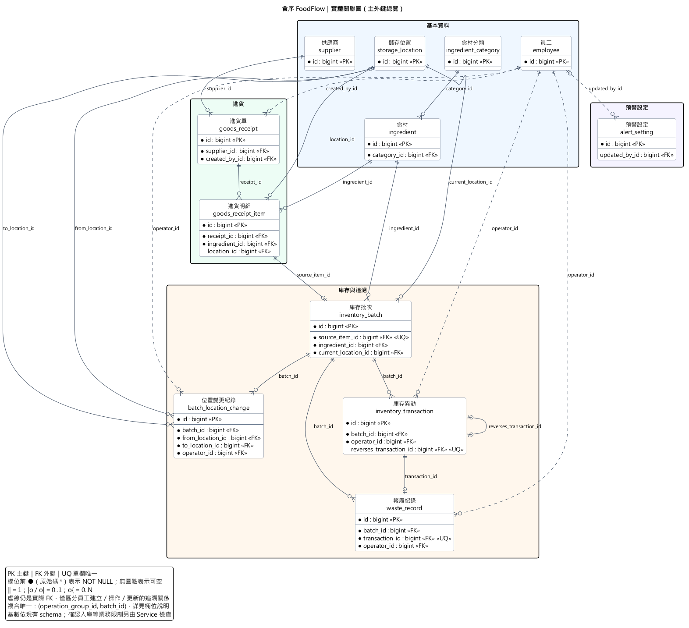
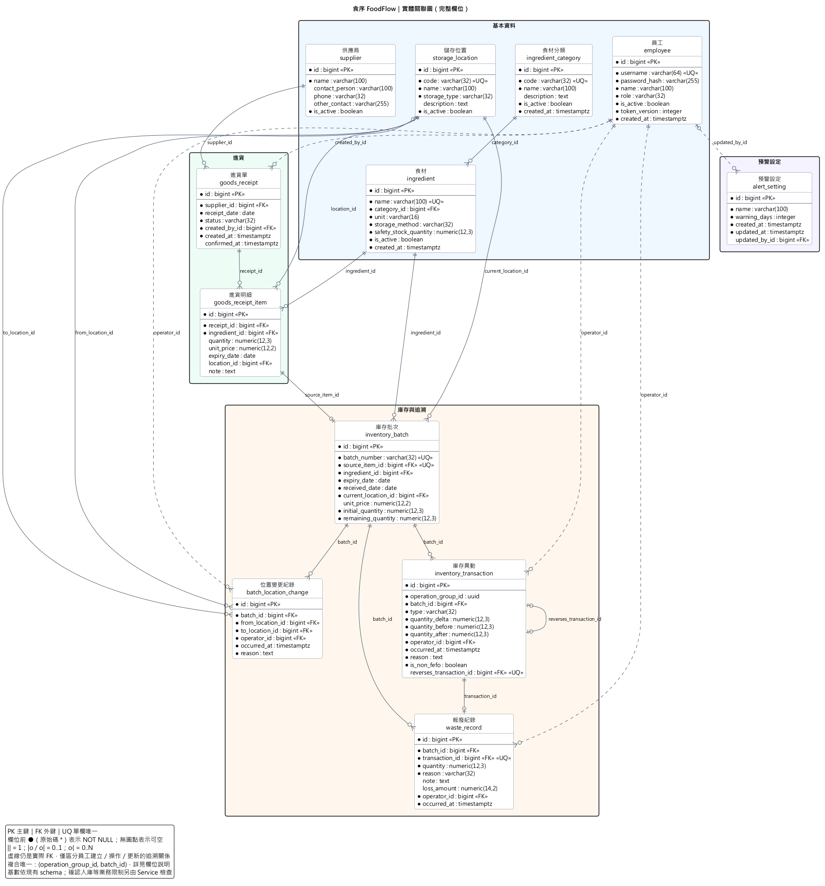

# 實體關聯圖與資料字典

本文件供 ChiaJungTien 整理 B 文件後半使用，範圍為全系統 12 張資料表。圖與欄位以現有模型及 migration 為準，需求名詞以 SRS v3.0 為準；本次不變更資料庫設計。

來源：

- [SRS v3.0](srs.md)，尤其第 4、5、8 節。
- [團隊分工](team-tasks.md)。
- [SQLAlchemy 模型](../backend/app/db/models/)與[初始 migration 0001](../backend/alembic/versions/20261105_0001_initial_schema.py)。
- [架構主幹](../_bmad-output/planning-artifacts/architecture/architecture-foodflow-2026-11-05/ARCHITECTURE-SPINE.md)。

## 1. ER 圖

### 1.1 主外鍵總覽

此圖保留全部 12 張表與全部外鍵，省略一般屬性；適合先看資料流與關聯。

[SVG 放大版](diagrams/b-er-overview.svg)｜[PlantUML 原始檔](diagrams/b-er-overview.puml)

### 1.2 完整欄位圖

[SVG 放大版](diagrams/b-er-diagram.svg)｜[PlantUML 原始檔](diagrams/b-er-diagram.puml)

### 1.3 讀圖方式

- PK：主鍵；FK：外鍵；UQ：單一欄位唯一。複合唯一另列，不能把兩欄各自視為唯一。
- 實心圓（PlantUML 原始碼的 `*`）表示 NOT NULL；沒有實心圓表示可空。
- `||` 表示 1，`|o`／`o|` 表示 0..1，`o{` 表示 0..N。圖依現有 schema 的可空性與唯一限制標記。
- 虛線是員工追溯關聯，與實線一樣都是實際存在的 FK；不同線型僅用來減少閱讀負擔。
- 所有表的 `id` 均為 `BIGINT GENERATED BY DEFAULT AS IDENTITY` 主鍵。
- `timestamptz` 是 PostgreSQL 的具時區時間戳；顯示及日期判斷依 Asia/Taipei 與可注入 Clock。

## 2. 關聯與基數

下表『父端』表示每筆子資料可指向幾筆父資料；『子端』表示每筆父資料可被幾筆子資料引用。

| 父表 | 子表／外鍵 | 父端 | 子端 |
| --- | --- | --- | --- |
| `employee.id` | `alert_setting.updated_by_id` | 0..1 | 0..N |
| `inventory_batch.id` | `batch_location_change.batch_id` | 1 | 0..N |
| `storage_location.id` | `batch_location_change.from_location_id` | 1 | 0..N |
| `employee.id` | `batch_location_change.operator_id` | 1 | 0..N |
| `storage_location.id` | `batch_location_change.to_location_id` | 1 | 0..N |
| `employee.id` | `goods_receipt.created_by_id` | 1 | 0..N |
| `supplier.id` | `goods_receipt.supplier_id` | 1 | 0..N |
| `ingredient.id` | `goods_receipt_item.ingredient_id` | 1 | 0..N |
| `storage_location.id` | `goods_receipt_item.location_id` | 0..1 | 0..N |
| `goods_receipt.id` | `goods_receipt_item.receipt_id` | 1 | 0..N |
| `ingredient_category.id` | `ingredient.category_id` | 1 | 0..N |
| `storage_location.id` | `inventory_batch.current_location_id` | 1 | 0..N |
| `ingredient.id` | `inventory_batch.ingredient_id` | 1 | 0..N |
| `goods_receipt_item.id` | `inventory_batch.source_item_id` | 1 | 0..1 |
| `inventory_batch.id` | `inventory_transaction.batch_id` | 1 | 0..N |
| `employee.id` | `inventory_transaction.operator_id` | 1 | 0..N |
| `inventory_transaction.id` | `inventory_transaction.reverses_transaction_id` | 0..1 | 0..1 |
| `inventory_batch.id` | `waste_record.batch_id` | 1 | 0..N |
| `employee.id` | `waste_record.operator_id` | 1 | 0..N |
| `inventory_transaction.id` | `waste_record.transaction_id` | 1 | 0..1 |

### 2.1 需要特別說明的關係

1. **進貨單 → 明細：**資料庫容許 0..N 筆明細；依 FR-06，確認入庫時至少一筆，這個條件必須由 Service 檢查。
2. **明細 → 批次：**每筆明細最多對應一個批次，靠 `inventory_batch.source_item_id` 的 UNIQUE 保證；草稿可以沒有批次。確認成功後每筆明細應有一個批次，須由同一交易完成。
3. **異動 → 報廢：**每筆報廢必須指向一筆異動，每筆異動最多對應一筆報廢；異動是否為 WASTE，以及數量、批次、操作者是否一致，並未由 FK 自動保證，須由 Service／StockLedger 保證。
4. **異動自我關聯：**`reverses_transaction_id` 可空且唯一。CHECK 保證只有 REVERSAL 必須指向原異動；UNIQUE 保證同一原異動最多被直接沖銷一次。是否可以沖銷仍須檢查後續異動等業務規則。
5. **位置：**批次只有一個目前位置；歷史由 `batch_location_change` 的原位置與新位置保存。不能把這三個角色合併成一條沒有名稱的關係。
6. **員工：**建單者、庫存異動操作者、報廢操作者、移位操作者、設定更新者是不同角色；圖中全部保留。

## 3. 各表欄位說明

可空欄位只表示 schema 容許 NULL，不代表所有操作都能省略。表中列舉值實際使用 `VARCHAR(32)` 搭配 CHECK，沒有額外的列舉資料表。

### 3.1 員工（`employee`）

| 欄位 | PostgreSQL 型別 | 鍵／參照 | 可空 | 說明 |
| --- | --- | --- | --- | --- |
| `id` | `bigint` | PK | 否 | 資料列識別碼，Identity 自動產生 |
| `username` | `varchar(64)` | UQ | 否 | 登入帳號，不得重複 |
| `password_hash` | `varchar(255)` | — | 否 | 密碼雜湊，不儲存明文密碼 |
| `name` | `varchar(100)` | — | 否 | 員工顯示姓名 |
| `role` | `varchar(32)` | — | 否 | 權限：ADMIN／STAFF |
| `is_active` | `boolean` | — | 否 | 帳號是否啟用 |
| `token_version` | `integer` | — | 否 | 驗證登入憑證的版本，用於撤銷既有登入 |
| `created_at` | `timestamptz` | — | 否 | 帳號建立時間 |

資料庫限制：

- `UNIQUE (username)`。
- `employee.role IN ('ADMIN', 'STAFF')`。

### 3.2 食材分類（`ingredient_category`）

| 欄位 | PostgreSQL 型別 | 鍵／參照 | 可空 | 說明 |
| --- | --- | --- | --- | --- |
| `id` | `bigint` | PK | 否 | 資料列識別碼，Identity 自動產生 |
| `code` | `varchar(32)` | UQ | 否 | 分類代碼，不得重複 |
| `name` | `varchar(100)` | — | 否 | 分類名稱 |
| `description` | `text` | — | 是 | 分類說明 |
| `is_active` | `boolean` | — | 否 | 分類是否啟用 |
| `created_at` | `timestamptz` | — | 否 | 分類建立時間 |

資料庫限制：

- `UNIQUE (code)`。

### 3.3 食材（`ingredient`）

| 欄位 | PostgreSQL 型別 | 鍵／參照 | 可空 | 說明 |
| --- | --- | --- | --- | --- |
| `id` | `bigint` | PK | 否 | 資料列識別碼，Identity 自動產生 |
| `name` | `varchar(100)` | UQ | 否 | 食材名稱，不得重複 |
| `category_id` | `bigint` | FK → `ingredient_category.id` | 否 | 所屬食材分類 |
| `unit` | `varchar(16)` | — | 否 | 固定庫存單位，不做自動單位換算 |
| `storage_method` | `varchar(32)` | — | 否 | 保存方式：REFRIGERATED／FROZEN／AMBIENT |
| `safety_stock_quantity` | `numeric(12,3)` | — | 否 | 安全庫存量，不得小於 0；0 表示不提醒 |
| `is_active` | `boolean` | — | 否 | 食材是否啟用 |
| `created_at` | `timestamptz` | — | 否 | 食材建立時間 |

資料庫限制：

- `UNIQUE (name)`。
- `ingredient.storage_method IN ('REFRIGERATED', 'FROZEN', 'AMBIENT')`。
- `safety_stock_quantity >= 0`。

### 3.4 供應商（`supplier`）

| 欄位 | PostgreSQL 型別 | 鍵／參照 | 可空 | 說明 |
| --- | --- | --- | --- | --- |
| `id` | `bigint` | PK | 否 | 資料列識別碼，Identity 自動產生 |
| `name` | `varchar(100)` | — | 否 | 供應商名稱 |
| `contact_person` | `varchar(100)` | — | 是 | 聯絡人 |
| `phone` | `varchar(32)` | — | 是 | 聯絡電話 |
| `other_contact` | `varchar(255)` | — | 是 | 其他聯絡方式 |
| `is_active` | `boolean` | — | 否 | 供應商是否啟用 |

### 3.5 儲存位置（`storage_location`）

| 欄位 | PostgreSQL 型別 | 鍵／參照 | 可空 | 說明 |
| --- | --- | --- | --- | --- |
| `id` | `bigint` | PK | 否 | 資料列識別碼，Identity 自動產生 |
| `code` | `varchar(32)` | UQ | 否 | 位置代碼，不得重複 |
| `name` | `varchar(100)` | — | 否 | 位置名稱 |
| `storage_type` | `varchar(32)` | — | 否 | 儲存類型：REFRIGERATED／FROZEN／AMBIENT |
| `description` | `text` | — | 是 | 位置說明 |
| `is_active` | `boolean` | — | 否 | 位置是否啟用 |

資料庫限制：

- `UNIQUE (code)`。
- `storage_location.storage_type IN ('REFRIGERATED', 'FROZEN', 'AMBIENT')`。

### 3.6 進貨單（`goods_receipt`）

| 欄位 | PostgreSQL 型別 | 鍵／參照 | 可空 | 說明 |
| --- | --- | --- | --- | --- |
| `id` | `bigint` | PK | 否 | 資料列識別碼，Identity 自動產生 |
| `supplier_id` | `bigint` | FK → `supplier.id` | 否 | 本張進貨單的供應商 |
| `receipt_date` | `date` | — | 否 | 實際進貨日期 |
| `status` | `varchar(32)` | — | 否 | DRAFT／CONFIRMED／REVERSED |
| `created_by_id` | `bigint` | FK → `employee.id` | 否 | 建立進貨單的員工 |
| `created_at` | `timestamptz` | — | 否 | 進貨單建立時間 |
| `confirmed_at` | `timestamptz` | — | 是 | 確認入庫時間；草稿可空白 |

資料庫限制：

- `goods_receipt.status IN ('DRAFT', 'CONFIRMED', 'REVERSED')`。

### 3.7 進貨明細（`goods_receipt_item`）

| 欄位 | PostgreSQL 型別 | 鍵／參照 | 可空 | 說明 |
| --- | --- | --- | --- | --- |
| `id` | `bigint` | PK | 否 | 資料列識別碼，Identity 自動產生 |
| `receipt_id` | `bigint` | FK → `goods_receipt.id` | 否 | 所屬進貨單 |
| `ingredient_id` | `bigint` | FK → `ingredient.id` | 否 | 本筆明細的食材 |
| `quantity` | `numeric(12,3)` | — | 是 | 進貨數量，草稿可空白；有值時必須大於 0 |
| `unit_price` | `numeric(12,2)` | — | 是 | 進貨單價，可不填；有值時不得小於 0 |
| `expiry_date` | `date` | — | 是 | 到期日，草稿可空白；確認入庫時必填 |
| `location_id` | `bigint` | FK → `storage_location.id` | 是 | 入庫位置，草稿可空白；確認入庫時必填 |
| `note` | `text` | — | 是 | 明細備註 |

資料庫限制：

- `quantity > 0`。
- `unit_price >= 0`。

### 3.8 庫存批次（`inventory_batch`）

| 欄位 | PostgreSQL 型別 | 鍵／參照 | 可空 | 說明 |
| --- | --- | --- | --- | --- |
| `id` | `bigint` | PK | 否 | 資料列識別碼，Identity 自動產生 |
| `batch_number` | `varchar(32)` | UQ | 否 | 唯一批號 |
| `source_item_id` | `bigint` | FK → `goods_receipt_item.id`；UQ | 否 | 來源進貨明細；唯一限制確保每筆明細最多建立一個批次 |
| `ingredient_id` | `bigint` | FK → `ingredient.id` | 否 | 批次所屬食材 |
| `expiry_date` | `date` | — | 否 | 批次到期日 |
| `received_date` | `date` | — | 否 | 進貨日期的不可變副本，供 FEFO 排序使用 |
| `current_location_id` | `bigint` | FK → `storage_location.id` | 否 | 批次目前的唯一儲存位置 |
| `unit_price` | `numeric(12,2)` | — | 是 | 批次進貨單價；未知時為 NULL |
| `initial_quantity` | `numeric(12,3)` | — | 否 | 初始入庫量，必須大於 0 |
| `remaining_quantity` | `numeric(12,3)` | — | 否 | 剩餘量，不得小於 0；只能由 StockLedger 修改 |

資料庫限制：

- `UNIQUE (batch_number)`。
- `UNIQUE (source_item_id)`。
- `initial_quantity > 0`。
- `remaining_quantity >= 0`。
- `unit_price >= 0`。

### 3.9 庫存異動（`inventory_transaction`）

| 欄位 | PostgreSQL 型別 | 鍵／參照 | 可空 | 說明 |
| --- | --- | --- | --- | --- |
| `id` | `bigint` | PK | 否 | 資料列識別碼，Identity 自動產生 |
| `operation_group_id` | `uuid` | — | 否 | 同次操作的群組 UUID；不是獨立資料表的外鍵 |
| `batch_id` | `bigint` | FK → `inventory_batch.id` | 否 | 本筆異動的庫存批次 |
| `type` | `varchar(32)` | — | 否 | RECEIPT／ISSUE／WASTE／ADJUSTMENT／REVERSAL |
| `quantity_delta` | `numeric(12,3)` | — | 否 | 本次增減量，可為正數或負數 |
| `quantity_before` | `numeric(12,3)` | — | 否 | 異動前數量 |
| `quantity_after` | `numeric(12,3)` | — | 否 | 異動後數量；等於異動前數量加增減量，且不得小於 0 |
| `operator_id` | `bigint` | FK → `employee.id` | 否 | 執行異動的員工 |
| `occurred_at` | `timestamptz` | — | 否 | 異動確認時間 |
| `reason` | `text` | — | 否 | 可顯示的異動原因文字 |
| `is_non_fefo` | `boolean` | — | 否 | 是否為非 FEFO 領用 |
| `reverses_transaction_id` | `bigint` | FK → `inventory_transaction.id`；UQ | 是 | 沖銷所指向的原異動；僅 REVERSAL 必填，且同一原異動最多被直接沖銷一次 |

資料庫限制：

- `UNIQUE (operation_group_id, batch_id)`。
- `UNIQUE (reverses_transaction_id)`。
- `(type = 'REVERSAL') = (reverses_transaction_id IS NOT NULL)`。
- `inventory_transaction.type IN ('RECEIPT', 'ISSUE', 'WASTE', 'ADJUSTMENT', 'REVERSAL')`。
- `quantity_after = quantity_before + quantity_delta`。
- `quantity_after >= 0`。

### 3.10 報廢紀錄（`waste_record`）

| 欄位 | PostgreSQL 型別 | 鍵／參照 | 可空 | 說明 |
| --- | --- | --- | --- | --- |
| `id` | `bigint` | PK | 否 | 資料列識別碼，Identity 自動產生 |
| `batch_id` | `bigint` | FK → `inventory_batch.id` | 否 | 報廢的庫存批次 |
| `transaction_id` | `bigint` | FK → `inventory_transaction.id`；UQ | 否 | 對應庫存異動，唯一；應為 WASTE 類型 |
| `quantity` | `numeric(12,3)` | — | 否 | 報廢量，必須大於 0 |
| `reason` | `varchar(32)` | — | 否 | EXPIRED／SPOILED／DAMAGED／OTHER |
| `note` | `text` | — | 是 | 補充說明；選擇 OTHER 時須由 Service 要求填寫 |
| `loss_amount` | `numeric(14,2)` | — | 是 | 報廢量乘以批次單價；單價未知時為 NULL，不視為 0 |
| `operator_id` | `bigint` | FK → `employee.id` | 否 | 登記報廢的員工 |
| `occurred_at` | `timestamptz` | — | 否 | 報廢確認時間 |

資料庫限制：

- `UNIQUE (transaction_id)`。
- `quantity > 0`。
- `waste_record.reason IN ('EXPIRED', 'SPOILED', 'DAMAGED', 'OTHER')`。

### 3.11 位置變更紀錄（`batch_location_change`）

| 欄位 | PostgreSQL 型別 | 鍵／參照 | 可空 | 說明 |
| --- | --- | --- | --- | --- |
| `id` | `bigint` | PK | 否 | 資料列識別碼，Identity 自動產生 |
| `batch_id` | `bigint` | FK → `inventory_batch.id` | 否 | 整批移位的庫存批次 |
| `from_location_id` | `bigint` | FK → `storage_location.id` | 否 | 移位前位置 |
| `to_location_id` | `bigint` | FK → `storage_location.id` | 否 | 移位後位置 |
| `operator_id` | `bigint` | FK → `employee.id` | 否 | 執行移位的員工 |
| `occurred_at` | `timestamptz` | — | 否 | 移位確認時間 |
| `reason` | `text` | — | 否 | 整批移位原因；不改變批次數量及到期日 |

### 3.12 預警設定（`alert_setting`）

| 欄位 | PostgreSQL 型別 | 鍵／參照 | 可空 | 說明 |
| --- | --- | --- | --- | --- |
| `id` | `bigint` | PK | 否 | 資料列識別碼，Identity 自動產生 |
| `name` | `varchar(100)` | — | 否 | 設定名稱 |
| `warning_days` | `integer` | — | 否 | 全店即期預警天數，不得小於 0 |
| `created_at` | `timestamptz` | — | 否 | 設定建立時間 |
| `updated_at` | `timestamptz` | — | 否 | 最後更新時間 |
| `updated_by_id` | `bigint` | FK → `employee.id` | 是 | 最後修改的員工；初始化時可空白 |

資料庫限制：

- `warning_days >= 0`。

## 4. 與需求及實作的對照

| 範圍 | 資料表／設計重點 |
| --- | --- |
| FR-01～02 帳號權限 | employee；歷史操作者保留，停用不代表刪除。 |
| FR-03～05 基本資料與位置 | ingredient_category、ingredient、supplier、storage_location；整批移位寫 batch_location_change。 |
| FR-06～07 進貨與沖銷 | goods_receipt、goods_receipt_item；確認時透過 StockLedger 建批次與異動，沖銷新增 REVERSAL，不覆寫已確認紀錄。 |
| FR-08～09 庫存查詢 | inventory_batch、inventory_transaction 及來源進貨；各種庫存量為查詢彙總，不另建庫存總覽表。 |
| FR-10～11 FEFO 領用 | inventory_batch、inventory_transaction；挑批次規則由 Strategy 處理，不新增領用單資料表。 |
| FR-12～14 預警 | alert_setting 搭配食材安全庫存與批次到期日即時計算，不儲存預警結果表。 |
| FR-15～16 報廢與盤點 | waste_record 與庫存異動；盤點使用 ADJUSTMENT 異動，沒有獨立盤點單表。 |
| FR-17～18 異動與統計 | inventory_transaction、batch_location_change、waste_record；報表為查詢結果。 |

## 5. Schema 與業務規則的界線

- `goods_receipt.receipt_number` 是 Python property（`GR-{id:08d}`），不是資料庫欄位；不要再畫一個實體欄位。
- 草稿明細的數量、到期日及位置可空；確認入庫時的必填、日期與啟用狀態檢查由 Service 負責。單價允許未知，不能強制填 0。
- 供應商至少一種聯絡方式、OTHER 報廢原因須有說明等跨欄位規則，目前未由資料庫 CHECK 保證。
- `operation_group_id` 是操作群組識別，不是 FK；`UNIQUE(operation_group_id, batch_id)` 防止同次操作對同批次重複記錄，並不是兩欄各自唯一。
- 食材分類名稱、供應商名稱及位置名稱目前沒有 UNIQUE；不能因業務直覺擅自加上 UQ。
- 批次的剩餘量與目前位置只能透過 StockLedger 寫入；交易邊界、鎖定順序與防重送依架構主幹 AD-5～AD-8、AD-20。
- 資料庫 CHECK 保證庫存異動的前後量平衡；整張單的原子性、來源明細與批次食材一致、沖銷條件仍需應用程式控制。
- `alert_setting` 由 migration 初始化為全店設定，程式取最小 id；schema 沒有強制整張表只能一列。`updated_by_id` 可空以支援初始化。
- 角色權限、即期天數及期限政策仍須依 SRS 的假設索引確認；這份 ER 圖沒有把未確認事項擴充成新表。

## 6. 本次核對範圍

已核對模型與 migration 0001 的 12 張表、93 個欄位、20 個外鍵，以及可空性與 UNIQUE 限制。PlantUML 圖依相同 metadata 建立。圖與說明為文件草稿，未變更 SRS、模型、migration 或資料庫資料。
