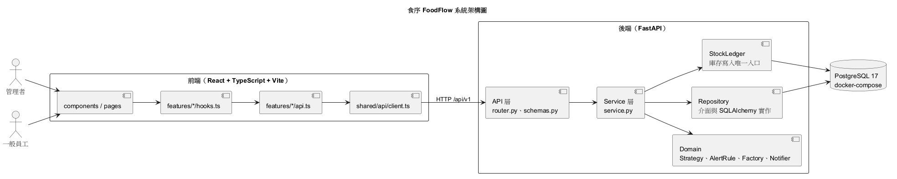
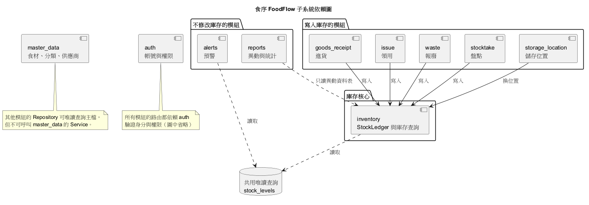

# 食序 FoodFlow：軟體設計文件（架構設計）

第 17 組。需求依據為 SRS v3.0（`docs/srs.md`）。完整的設計規則見 `_bmad-output/planning-artifacts/architecture/architecture-foodflow-2026-11-05/ARCHITECTURE-SPINE.md`。

> 本文件是期中前的設計，程式尚在開發。檔案路徑與變更檢驗表要在程式完成後，依實際結果核對。

## 1. 專案動機與目的

許多餐廳的食材仍以紙本或試算表管理：進貨時沒有記錄效期，領用時憑印象拿，發現過期時往往只能報廢；也常常用完才發現沒叫貨。餐廳的食材品項、批次、儲存空間與經手的員工越多，靠人記憶就越不可靠。

食序 FoodFlow 集中記錄每次進貨及其庫存批次，讓員工清楚知道還有哪些食材、剩多少、放在哪裡、哪一批應該先使用，並留下領用、報廢與盤點調整的紀錄，方便追查食材去向與浪費原因。

目前沒有實際餐廳的試用數據，因此不預設能降低特定百分比的損耗。系統依輸入的日期提供提醒，不取代員工對食材狀況的判斷。

## 2. 系統特色

- **批次追蹤：** 以庫存批次而非品項追蹤，同一食材的不同到期日、位置與單價分開記錄。
- **FEFO 領用：** 依先到期先使用建議批次；員工可改選，但須填原因，並標記為非 FEFO。
- **效期與低庫存預警：** 首頁依過期、今日到期、即期、低庫存排序，可直接進入領用、報廢或建立進貨單。
- **報廢分析：** 保留報廢原因、數量與損失金額，並依食材、分類與原因統計。
- **可追溯：** 所有數量變動都有操作者、時間與來源，可由異動紀錄重算目前庫存。

## 3. 使用者定位

產品定位是單一門市、非連鎖的獨立餐廳，不限規模，以平板及電腦 Web 操作。供應商不登入本系統；首版不提供連鎖總部、跨分店調撥與中央廚房功能。

| 使用者 | 主要工作 | 系統權限 |
| --- | --- | --- |
| 餐廳負責人／店長 | 掌握庫存與效期、維護資料與權限、檢視報廢及盤點差異 | 管理者 |
| 收貨／採購人員 | 記錄進貨、到期日、單價與位置，知道哪些食材要補貨 | 一般員工 |
| 廚房／備料人員 | 查找食材、依批次建議領用、登記報廢 | 一般員工 |

## 4. 系統架構圖

系統由三部分組成：瀏覽器中的前端、提供 `/api/v1` 的後端，以及 PostgreSQL 資料庫。首版沒有背景工作，預警在每次查詢時即時計算，因此不會與庫存不同步。

開發時前端由 Vite 提供，並將 `/api` 轉送後端；demo 時由 FastAPI 一併提供前端靜態檔。兩種方式都維持同源，只在本機或區網使用。

## 5. 各層角色與職責

本系統採用課程設計層次 4：API → Service → Repository 分層，Service 透過建構子注入 Repository 介面。

### 5.1 Controller（API 層）

| 項目 | 內容 |
| --- | --- |
| 角色與定位 | 系統對外的入口，對應 `router.py` 與 `schemas.py` |
| 負責任務 | 驗證輸入格式；驗證登入與權限；呼叫 Service；轉換成回應格式 |
| 不應包含 | 商業規則、SQL、交易控制、對 Repository 的呼叫 |
| 例外處理 | 由單一 exception handler 把 `DomainError` 與格式錯誤轉成統一的 HTTP 錯誤格式，錯誤欄位以路徑標示（例如 `lines.0.quantity`）。未預期的例外回 `500 INTERNAL_ERROR`，不回傳內部細節 |

### 5.2 Service

| 項目 | 內容 |
| --- | --- |
| 角色與定位 | 商業規則與交易的所在，對應 `service.py` |
| 負責任務 | 執行規則（例如確認入庫、FEFO 領用）；決定交易範圍；協調 Repository、StockLedger、Domain 與 Clock |
| 不應包含 | HTTP、SQL、`Session`；不可自己建立 Repository、Strategy 或 Clock，一律由建構子注入 |
| 例外處理 | 規則不符時丟 `DomainError`，例如 `INSUFFICIENT_STOCK`、`STALE_QUANTITY`。交易區塊內發生例外時全部回滾 |

每個寫入操作都在單一交易內完成。多批次領用與確認入庫全部成功或全部不生效。

### 5.3 Repository

| 項目 | 內容 |
| --- | --- |
| 角色與定位 | 隔離資料存取。介面在 `repository.py`，SQLAlchemy 實作在 `repository_sqlalchemy.py` |
| 負責任務 | 以業務語言提供查詢與儲存；載入需要的關聯 |
| 不應包含 | 商業判斷；`commit` 或 `rollback` |
| 例外處理 | 把資料庫限制違反（例如唯一鍵）依 constraint 名稱轉成 `DomainError`，上層不需要接觸 SQLAlchemy 的例外 |

**StockLedger** 是庫存專用的資料存取元件。批次剩餘量、批次位置與異動紀錄只能經由它修改，避免進貨、領用、報廢、盤點各寫一份扣庫存邏輯。它也是批次列鎖的唯一入口，一律依 `id` 遞增上鎖以避免死結，鎖定後一定讀取最新值，並在同一筆異動留下前後量。

**已知取捨：** 領域物件綁定 ORM。SQLAlchemy 模型同時作為實體類別，Service 因此間接依賴 SQLAlchemy，沒有達到領域層完全獨立。原因是四人要在期中前完成 12 張表與八大功能，另建映射層等於每張表多寫一套類別與轉換，也多一處出錯的地方。代價由三點控制：Service 不可直接 import `sqlalchemy`、關聯不可延遲載入、Strategy 與 AlertRule 使用純資料物件。換其他 SQL 資料庫不受影響；換非 SQL 資料庫時要改寫模型。

### 5.4 Domain（Strategy／Factory）

| 項目 | 內容 |
| --- | --- |
| 角色與定位 | 不依賴資料庫與 HTTP 的純邏輯，可單獨測試 |
| 負責任務 | 批次挑選：`BatchSelectionStrategy`，實作 `FefoStrategy`、`ManualStrategy`。預警規則：`AlertRule`，實作過期、今日到期、即期、低庫存四個規則，由 `AlertRuleFactory` 依預警設定組合。效期與低庫存判定：`classify_expiry`、`is_low_stock` |
| 不應包含 | 資料庫查詢、HTTP、讀取系統時間 |
| 例外處理 | 不處理交易與 HTTP；資料由 Service 先過濾並傳入，Service 負責把結果轉成 `DomainError` |

日期一律來自可注入的 `Clock`，正式環境使用 `SystemClock`，測試使用 `FixedClock`，判定依 Asia/Taipei 的當日日期。

### 5.5 通知 Adapter

| 項目 | 內容 |
| --- | --- |
| 角色與定位 | 隔離預警與通知管道，介面為 `Notifier` |
| 負責任務 | 期中只有 `InAppNotifier`，它的投遞管道就是 API 回應，把預警交給首頁顯示 |
| 不應包含 | 預警判定、庫存查詢；不可在查詢頁面時觸發外部通知 |
| 例外處理 | `InAppNotifier` 不對外連線。期末若加外部通知，由獨立的進入點觸發，失敗時記錄日誌，不影響庫存與站內預警 |

### 5.6 防重送與併發

| 操作 | 防護方式 | 重送結果 |
| --- | --- | --- |
| 確認入庫、進貨沖銷 | 單據狀態機，鎖單頭後檢查狀態 | 回 200 與單據目前狀態，不重複入庫 |
| 領用、報廢 | 前端帶 `Idempotency-Key`，鎖定後先查是否已處理 | 回 200 與原結果 |
| 盤點調整 | 帶預覽時的帳面量，鎖定後比對 | 不符時回 409，要求重新核對 |

兩人同時領用時，第二人在等到列鎖後，會看到最新剩餘量。餘量不足時回 409 與最新可用量，不會產生負庫存。

## 6. 子系統切割

依 SRS 第 4 節的八大功能切分。前端的 feature 採相同切法。

| 八大功能 | 後端模組 | FR | 負責人 |
| --- | --- | --- | --- |
| 帳號與權限管理 | `auth` | FR-01、FR-02 | 謝文佳 |
| 基本資料與儲存位置管理 | `master_data`、`storage_location` | FR-03～FR-05 | 謝文佳、Ken |
| 進貨與批次管理 | `goods_receipt` | FR-06、FR-07 | ChiaJungTien |
| 批次庫存查詢 | `inventory` | FR-08、FR-09 | ChiaJungTien（`StockLedger` 由 Ken 負責） |
| 食材領用與消耗登記 | `issue` | FR-10、FR-11 | Ken |
| 效期與低庫存預警 | `alerts` | FR-12～FR-14 | 謝文佳 |
| 報廢與盤點 | `waste`、`stocktake` | FR-15、FR-16 | 郭明儒 |
| 異動紀錄與統計 | `reports` | FR-17、FR-18 | 郭明儒 |

**切割理由：**

- 每個功能的規則變動原因不同，分開後四人可以平行開發。
- 報廢與盤點雖然屬於同一功能，但流程與防重送方式不同，所以分成兩個模組；基本資料與儲存位置也因負責人與換位置流程不同而分開。
- 多個模組都會改庫存，所以把庫存寫入集中到 `inventory.StockLedger`，避免規則重複。

**資料表寫入權：** 每張表只有一個模組可以寫入，讀取不受限。

| 資料表 | 寫入者 |
| --- | --- |
| `employee` | `auth` |
| `ingredient_category`、`ingredient`、`supplier` | `master_data` |
| `storage_location` | `storage_location` |
| `goods_receipt`、`goods_receipt_item` | `goods_receipt` |
| `inventory_batch`、`inventory_transaction`、`batch_location_change` | `inventory.StockLedger` |
| `waste_record` | `waste` |
| `alert_setting` | `alerts` |

**模組間依賴：** 模組不可呼叫彼此的 Service 或 Repository，只有兩個例外：

- 會改庫存的模組依賴 `inventory.StockLedger`。
- 所有路由依賴 `auth` 提供的身分與權限檢查。

低庫存與可用量由共用的唯讀查詢及判定函式提供，首頁與庫存總覽的結果因此一致。

## 7. 變更檢驗表

本表檢驗設計是否能把變更限制在小範圍內。目前依設計推導，尚未以實際程式驗證。路徑中的 `app/` 指 `backend/app/`。

| 情境 | 新增 | 修改 | 不用改 |
| --- | --- | --- | --- |
| **C1 新增預警規則** | `app/modules/alerts/rules/<new>_rule.py`、對應單元測試 | `alerts/rule_factory.py`（註冊一行）；`alerts/rules/base.py`（`AlertKind` 加一個值）；`frontend/src/shared/ui/statusBadgeMap.ts`（顯示文字與顏色）；重新產生 `schema.d.ts` | 既有四個規則、`AlertService`、`router.py`、`Notifier` |
| **C2 換挑批次規則** | `app/modules/issue/strategies/<new>_strategy.py`、對應單元測試 | `issue/dependencies.py`（換注入的預設策略一行） | `IssueService`、`ManualStrategy`、`router.py`、`StockLedger`、Repository、前端 |
| **C3 加外部通知** | `app/modules/alerts/notifiers/<channel>_notifier.py`；`app/jobs/daily_alert_digest.py`（排程進入點）；對應測試 | `core/config.py`、`.env.example`（通道設定）；`docker-compose.yml` 或系統排程（觸發 job）；`pyproject.toml`（若需要新套件） | 所有 `AlertRule`、`AlertRuleFactory`、`InAppNotifier`、`AlertService`、`alerts/dependencies.py`、`router.py`、前端 |
| **C4 換資料庫**（其他 SQL 資料庫） | 新資料庫的 baseline migration | `docker-compose.yml`、`docker/initdb/`、`.env.example`、`pyproject.toml`（driver）；`core/db.py`；`alembic/env.py`；`db/models/` 與 `db/queries/`（僅不相容的型別或語法）；`modules/*/repository_sqlalchemy.py`、`inventory/ledger_sqlalchemy.py`（僅不相容的查詢）；`scripts/backup.sh`、`restore.sh` | 所有 `service.py`、`router.py`、`schemas.py`、Domain、Repository 介面、`StockLedger` 介面、前端 |
| **C5 測試跨日** | `backend/tests/` 下的測試案例 | 無正式程式碼。單元測試注入 `FixedClock`；API 測試用 `app.dependency_overrides[get_clock]`；手動驗收設定 `APP_FIXED_NOW` | `SystemClock`、`service.py`、`router.py`、Domain、Repository |

補充：

- **C1：** 若新規則需要新資料，還要改 `AlertContext` 與載入它的 Repository；若預警是新形狀，還要改 `Alert` 與 `alerts/schemas.py`。兩種情況既有規則都不用改。
- **C2：** 換成非 FEFO 策略後，`is_non_fefo` 的實際意義變成「偏離系統建議」，欄位名稱與報表文字要另外決定是否調整。
- **C3：** 外部 Notifier 只由 job 使用，查詢預警仍使用 `InAppNotifier`，不會在查詢時發送外部通知。C3 需要新增排程進入點，屬於期末延伸，首版沒有。
- **C4：** 換資料庫後要重跑整合測試，並確認隔離層級為 `READ COMMITTED`。換成非 SQL 資料庫時，還要重寫所有 Repository 與 StockLedger 實作、`UnitOfWork` 及模型類別，也要重新評估列鎖機制。
- **C5：** 驗收時要包含「設定 `APP_FIXED_NOW` 後可登入並完成一次寫入」。

## 8. 技術選型

| 部分 | 技術 | 理由 |
| --- | --- | --- |
| 前端框架 | React、TypeScript、Vite | 元件化適合多功能頁面；TypeScript 可在編譯時抓出前後端欄位不符 |
| UI | Mantine | 內建表單與表格元件，減少自刻介面的時間 |
| 資料請求 | TanStack Query | 統一快取與失效，領用後可讓預警與庫存畫面同步更新 |
| 路由 | React Router | 只處理頁面路由；伺服器資料一律交給 TanStack Query |
| 後端框架 | Python FastAPI | `Depends` 可實作建構子注入的組裝；自動產生 OpenAPI，可據此產生前端型別 |
| 資料存取 | SQLAlchemy 2、Alembic | 支援列鎖與交易；migration 讓四人的 schema 保持一致 |
| 資料驗證 | Pydantic | 可嚴格驗證數量格式，超過三位小數時明確拒絕 |
| 資料庫 | PostgreSQL（docker-compose） | 支援 `NUMERIC(12,3)` 與列鎖，能滿足併發領用不超領的需求；容器讓全組環境一致 |

開發環境版本見 `README.md`，所有套件版本見架構主幹的 Stack 章節。
